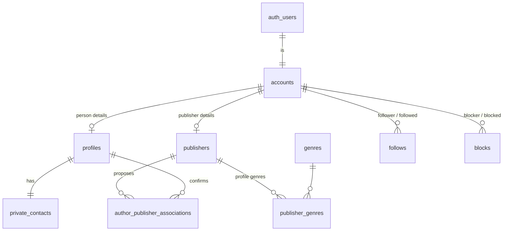
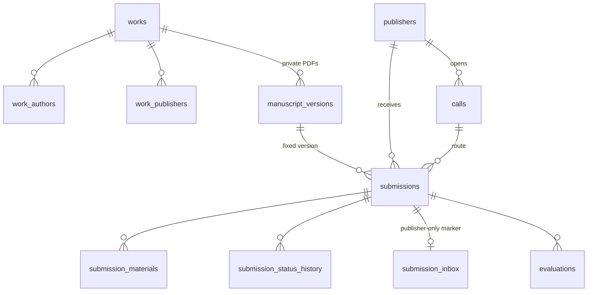
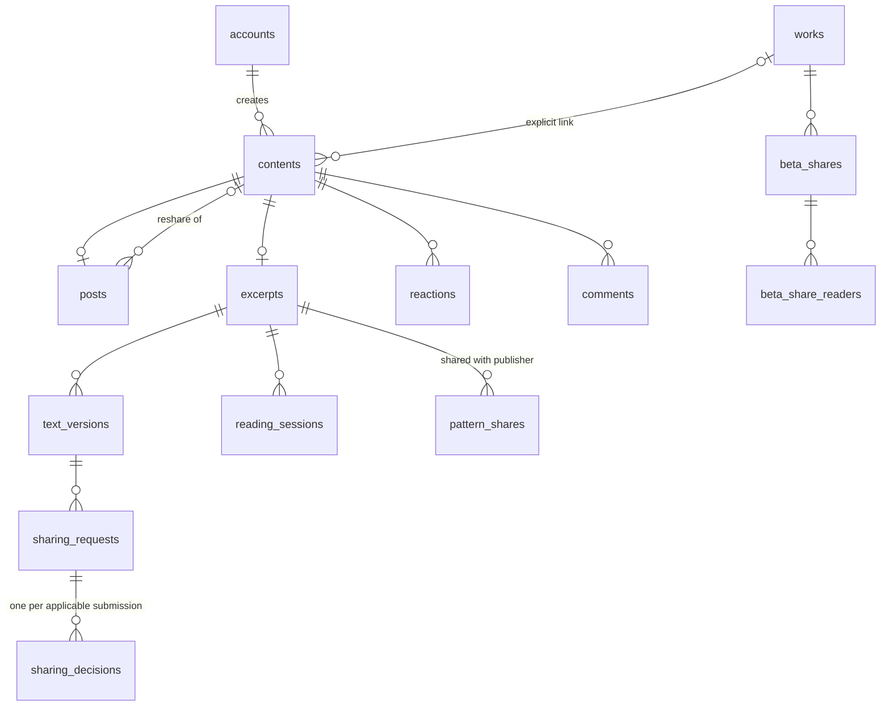
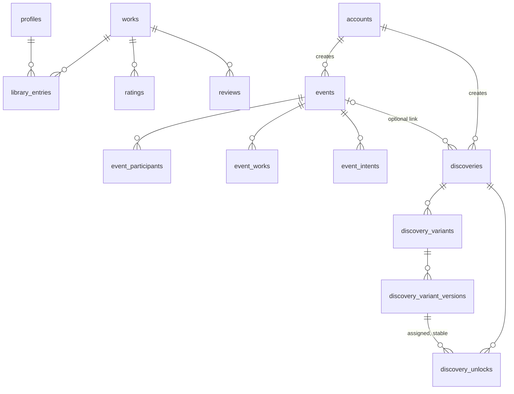

# Lisette database design

Status: proposal for review (2026-10-21). Backend approved: Supabase (Postgres, Auth, Storage, Edge Functions). Product rules come from `../../product/requirements.md`; this document only decides how they are stored. Task order and ownership are in the delivery plan (`../plans/2026-10-17-lisette-delivery.md`); plans name tables and never redefine them.

## 1. Intent

One relational schema that covers every confirmed first-version function for writers, readers and publishers, with privacy enforced in the database (row-level security plus a few transactional functions) rather than in the app. Brainstorm user stories (2026-10-21) map onto it as follows:

| User story | Where it lives |
|---|---|
| Writer sends manuscripts to publications | `manuscript_versions`, `submissions`, `submission_materials`, `calls` |
| Writer profile with books and magazine appearances | `profiles`, `works`, `work_authors`, `portfolio_entries` |
| Writer shares fragments, with publisher approval where needed | `contents` + `excerpts` + `text_versions`, `sharing_requests`, `sharing_decisions` |
| Writer leaves location "easter eggs" / reader unlocks special fragments | `discoveries`, `discovery_variants`, `discovery_variant_versions`, `discovery_unlocks` |
| Writer uses beta-readers | `beta_shares`, `beta_share_readers` |
| Everyone posts; event posts | `contents` + `posts`, `events` |
| Publication registers as publishing house, magazine or independent editor | `publishers.kind` |
| Publication receives material and announces calls | `submissions`, `calls` |
| Reader follows writers and publications | `accounts`, `follows` |
| Publication shares quotes or fragments as a preview | `excerpts.source`, `sharing_requests.author_decision` |
| Reader library and book scan | `works` (ISBN), `library_entries` |
| Reader reads public fragments, gives opinions | `excerpts`, `reactions`, `comments`, `reviews`, `ratings` |
| Reader finds nearby events | `events` (PostGIS location) |
| Reader contributes to the reading report | `reading_consents`, `reading_sessions`, `pattern_shares` |
| Reader genre preferences | Deferred (section 10) |

## 2. Goals, non-goals, anti-goals

- **Goals:** every confirmed rule has an obvious home; private data cannot leak through a forgotten query; history (submissions, statuses, unlocks) is never rewritten.
- **Non-goals:** genre preferences, multi-user publisher teams, chat, payments, ticketing, OS push, retention/deletion schedules (still undecided).
- **Anti-goals:** a publisher, admin or other reader reaching a manuscript, contact detail, evaluation, opened marker or per-reader reading data they are not entitled to; any table that stores audio; any score or average.

## 3. Conventions

- Primary keys `uuid default gen_random_uuid()`; `created_at timestamptz default now()`; `updated_at` where rows are edited.
- Small fixed value sets are Postgres enums (listed in section 5). Language codes are ISO 639-1 `text`.
- Every table exposed to clients has RLS enabled. Clients read through RLS-filtered tables or views; any write that checks several rules (submit, transition, approve, unlock, publish) goes through a `security definer` function that derives the caller from `auth.uid()`.
- Moderation uses `hidden_at` columns; owner deletion of public content uses `deleted_at` (soft) where other rows reference it (reshares, comments, reports). Immutable rows (versions, history, unlocks) have no update/delete policy at all.
- Locations use PostGIS `geography(Point, 4326)` (enable the `postgis` extension).
- Files live in Storage; tables hold the object path, never a public URL for private files.

## 4. Who acts: accounts, profiles, publishers

Every login is one Supabase user and one `accounts` row of a single kind (confirmed 2026-10-21): a **person** (reader, plus author once activated) or a **publisher** (publishing house, literary magazine or independent editor). A publication has its own login and email; it is never attached to a person's account, and one account is at most one publication. Publisher accounts have no personal library, ratings, reviews, beta-reading or reading-pattern consent. Anything that can be followed, blocked, credited or invited (posts, comments, events, discoveries, follows, blocks) points to `accounts`, so a reader follows an author and a magazine through the same table.

| Table | Key columns | Notes |
|---|---|---|
| `accounts` | `id` (= `auth.users.id`), `kind` (`account_kind`), `locale` (`ro`/`en`), `suspended_at`, `created_at` | Kind is fixed at sign-up. Exactly one of `profiles` / `publishers` exists for it, matching `kind`. |
| `profiles` | `id` → `accounts`, `display_name`, `pen_name`, `avatar_path`, `bio`, `links jsonb` (blog/site/social), `author_enabled`, `author_activated_at` | Person accounts only. |
| `private_contacts` | `user_id` PK → `profiles`, `contact_email`, `phone` | Owner-only. Copied into a submission at send time. |
| `admins` | `user_id` PK → `profiles` | Team members use person accounts. Inserted only by a trusted setup operation. |
| `publishers` | `id` → `accounts`, `kind` (`publisher_kind`), `name`, `intro`, `logo_path`, `website`, `approval_status`, `verification_method` (`official_email`/`direct_confirmation`), `reviewed_by` → `admins`, `reviewed_at`, `resubmission_allowed` default false, `sharing_policy` | Publisher accounts only; the login is the single administrator. A pending request is a `pending` row. Before approval the account can post, comment, share quotes and create events and discoveries; only receiving manuscripts needs `approved` (`can_receive_submissions()`), and its calls are not shown as open until then. Intake criteria live on `calls`; "accepts submissions now" is computed from having at least one open call. |
| `genres` | `id`, `code` unique, `name_ro`, `name_en` | Seeded list; reused later for reader preferences. |
| `publisher_genres` | `publisher_id`, `genre_id` (PK both) | Genres the publication works with, shown on its profile and used by the catalogue genre filter. Independent of the genres a given call accepts (`call_genres`). |
| `follows` | `follower_id`, `followed_id` (PK both, → `accounts`), `created_at` | Check: not self. Rejected if a block exists either way. |
| `blocks` | `blocker_id`, `blocked_id` (PK both, → `accounts`) | Blocking a publisher stops new submissions to it only. |
| `author_publisher_associations` | `id`, `publisher_id`, `author_id`, `status` (`pending`/`confirmed`/`declined`), `responded_at`; unique (`publisher_id`, `author_id`) | Public only when `confirmed`. |

**Requirement flags** (on `calls` only; decided 2026-10-21): `req_full_manuscript`, `req_synopsis`, `req_sample`, `req_genre`, `req_author_intro` (all `boolean`). Five columns are simpler than a separate requirements table and cover the agreed fields; custom questionnaires are out of scope.

## 5. Enums

Column-level types, nullability, defaults and proposed limits for every table are in the visual companion `lisette-schema.html` (same folder); keep the two in sync. Limits marked "proposal" there are starting values, not decisions.

| Enum | Values |
|---|---|
| `app_locale` | `ro`, `en` |
| `publisher_kind` | `publishing_house`, `literary_magazine`, `independent_editor` |
| `approval_status` | `pending`, `approved`, `rejected`, `suspended` |
| `verification_method` | `official_email`, `direct_confirmation` |
| `sharing_policy` | `author_controlled`, `synopsis_approval`, `synopsis_and_excerpt_approval` |
| `account_kind` | `person`, `publisher` |
| `excerpt_source` | `own_work`, `own_book`, `received_manuscript` |
| `link_status` | `pending`, `confirmed`, `declined` (participants, associations, work links) |
| `work_visibility` | `private`, `public` |
| `work_source` | `author`, `isbn_lookup`, `manual` |
| `portfolio_kind` | `book`, `newspaper`, `magazine`, `anthology` |
| `submission_status` | `submitted`, `in_review`, `on_hold`, `selected`, `rejected`, `withdrawn` |
| `material_kind` | `synopsis`, `sample`, `author_intro` |
| `content_kind` | `post`, `excerpt` |
| `share_kind` | `synopsis`, `excerpt`, `beta_pages` |
| `audience` | `public`, `followers` (beta access is a separate grant) |
| `decision` | `pending`, `approved`, `refused` |
| `reaction_kind` | `love`, `okay`, `dislike` (working IDs; labels belong to design) |
| `beta_invite_status` | `invited`, `accepted`, `declined`, `revoked` |
| `consent_level` | `off`, `standard`, `no_threshold` |
| `motion_context` | `still`, `moving` |
| `noise_level` | `quiet`, `moderate`, `loud` |
| `shelf` | `to_read`, `reading`, `read` |
| `event_intent` | `interested`, `going` |
| `notification_channel` | `in_app`, `email` |
| `delivery_status` | `pending`, `sent`, `failed` |
| `report_target` | `profile`, `publisher`, `post`, `excerpt`, `comment`, `review`, `event`, `discovery` |
| `report_status` | `open`, `dismissed`, `actioned` |
| `moderation_action` | `dismiss`, `hide`, `suspend`, `remove` |
| `deletion_status` | `requested`, `in_review`, `completed` |

## 6. Works, manuscripts and submissions

A **work** is the public identity of a book or project: a published book found by ISBN, or an author's unpublished project. A manuscript is simply the private PDF versions of a work owned by its author. There is no separate `manuscripts` table.

| Table | Key columns | Notes |
|---|---|---|
| `works` | `id`, `title`, `description`, `owner_id` null → `profiles` (author-owned projects), `is_published`, `isbn` unique null, `author_names text[]` (from metadata, for authors not on Lisette), `publisher_name` text null, `language`, `genre_id` null, `cover_path`, `visibility` (`private`/`public`), `source` (`author`/`isbn_lookup`/`manual`), `external_id` | Central book table: one row per book, shared by all users. ISBN lookups are cached here. Manual adds first search similar titles/authors (`pg_trgm` index on `title` and `author_names`) for "Is this the book?"; never auto-merged. Unpublished works are private until the author makes them public (Work in progress). Ratings/reviews only when `is_published`. |
| `work_authors` | `work_id`, `author_id` (PK both), `status` (`link_status`) | Explicit link to a Lisette author; never guessed. Owner's own work is created `confirmed`. |
| `work_publishers` | `work_id`, `publisher_id` (PK both), `status` | Book-association rules still open; only `confirmed` is public. |
| `portfolio_entries` | `id`, `author_id`, `kind` (`portfolio_kind`), `title`, `outlet`, `year`, `url`, `work_id` null | Self-reported, no verification badge. |
| `manuscript_versions` | `id`, `work_id`, `storage_path`, `sha256`, `byte_size`, `page_count`, `label`, `uploaded_at` | Immutable. Owner-only through the file gateway. Upload requires the work's `owner_id = auth.uid()`. |
| `calls` | `id`, `publisher_id`, `title`, `description`, `opens_at`, `closes_at` null, `accepted_languages text[]`, requirement flags, `published_at` null, `cancelled_at` null | Every way into a publication is a call (decided 2026-10-21). `closes_at` null = always open (the former ongoing direct submissions). A publication may have several open calls with different criteria. Open = published, not cancelled, `opens_at` passed and `closes_at` null or in the future. No call/competition kind: a competition is named as such in its title. |
| `call_genres` | `call_id`, `genre_id` (PK both) | Genres this call accepts; none = any genre. |
| `submissions` | `id`, `author_id`, `work_id`, `version_id`, `publisher_id` (copied from the call, for the duplicate rule), `call_id`, `genre_id` null, `status`, `contact_email`, `contact_phone`, `rights_declared_at`, `contact_consent_at`, `accepted_policy jsonb` (requirements + `sharing_policy` at send time), `idempotency_key` unique, `submitted_at`, `status_changed_at` | Readable only by the author and the recipient publisher's owner. Partial unique index on (`work_id`, `publisher_id`) where status in (`submitted`, `in_review`, `on_hold`, `selected`) enforces one active submission per work and publisher. Status changes only through `transition_submission` / `withdraw_submission`. |
| `submission_materials` | `id`, `submission_id`, `kind` (`material_kind`), `body` text null, `storage_path` null; unique (`submission_id`, `kind`) | The full manuscript is `version_id`; genre is a column. Immutable after send. |
| `submission_status_history` | `id`, `submission_id`, `from_status`, `to_status`, `changed_by`, `note`, `changed_at` | Append-only. |
| `submission_inbox` | `submission_id` PK, `opened_at` | Publisher-only (author has no policy); set by the gateway on first read. Separate table because RLS cannot hide one column. |
| `evaluations` | `id`, `submission_id`, `history_id` unique null, `stood_out`, `could_improve`, `observations`, `created_at` | Private to author and recipient. Selecting requires one non-empty field (checked in `transition_submission`). |

**Access to the PDF** is computed, not stored: the owner always; the recipient publisher for `submitted`/`in_review`/`selected` (read and download) and `on_hold` (read only); nobody else. Withdrawal or rejection removes access because the status changed; no grant rows to clean up.

## 7. Community, sharing and reading patterns

Posts and excerpts share one `contents` table, so reactions, comments, reshares and reports point to a single ID.

| Table | Key columns | Notes |
|---|---|---|
| `contents` | `id`, `kind`, `account_id`, `work_id` null, `created_at`, `updated_at`, `deleted_at`, `hidden_at` | Visible if not deleted/hidden, no block between viewer and creator, and the subtype rule allows it. |
| `posts` | `content_id` PK, `body` null, `reshare_of` null → `contents` | Always public. Needs text or an image or a reshare target. A reshare shows nothing once its source is not visible to the viewer. |
| `post_images` | `id`, `content_id`, `storage_path`, `position` | Public media bucket. |
| `excerpts` | `content_id` PK, `share_kind` (`synopsis`/`excerpt`), `source` (`excerpt_source`), `submission_id` null, `audience`, `published_version_id` null → `text_versions` | `share_kind` limited to `synopsis`/`excerpt` by a check. `source`: `own_work` (author's own work), `own_book` (publisher quoting a work confirmed in `work_publishers`, no approval needed), `received_manuscript` (publisher quoting a manuscript submitted to it; `submission_id` set; needs an approved sharing request including the author's approval). Readers see only `published_version_id`. Followers-only requires a `follows` row. |
| `text_versions` | `id`, `excerpt_id`, `body`, `sha256`, `created_at` | Immutable; editing creates a new version, which needs fresh approval. |
| `sharing_requests` | `id`, `requested_by` → `accounts`, `work_id`, `kind` (`share_kind`), `text_version_id` null, `beta_share_id` null, `author_decision` null (`decision`), `author_decided_at` | Check: exactly one target. When a publisher requests a quote from a received manuscript, the author must approve the exact text (`author_decision = approved`); other publishers whose accepted restrictions apply still decide in `sharing_decisions`, excluding the requester. |
| `sharing_decisions` | `request_id`, `submission_id` (PK both), `publisher_id`, `decision`, `decided_at` | Created by `request_sharing` for every active submission of the work whose accepted policy covers the kind. Publishing is allowed when every row for still-active submissions is `approved`. |
| `reactions` | `account_id`, `content_id` (PK both), `kind` | One per account per content. |
| `comments` | `id`, `content_id`, `parent_id` null, `account_id`, `body`, `created_at`, `updated_at`, `deleted_at`, `hidden_at` | Replies via `parent_id`. |
| `beta_shares` | `id`, `work_id`, `version_id`, `page_ranges int4multirange`, `derived_path` | Derived PDF with only the granted pages; read in-app only. Active once its sharing request (if any) is approved. |
| `beta_share_readers` | `share_id`, `reader_id` (PK both), `status` (`invited`/`accepted`/`declined`/`revoked`), `responded_at`, `revoked_at` | Access needs `accepted`. |
| `reading_consents` | `user_id` PK, `level` (`consent_level`), `noise_allowed`, `updated_at` | Default `off` (row absent = off). |
| `reading_sessions` | `id`, `reader_id`, `excerpt_id`, `text_version_id`, `consent_level` (snapshot), `segments jsonb` (`[{segment, ms, revisits}]`), `stop_segment`, `motion` null, `noise` null, `created_at` | No client select policy at all. `record_reading_session` accepts only public excerpts and readers with consent; only aggregate functions read it, applying the 10-reader threshold. No audio is ever stored. |
| `pattern_shares` | `excerpt_id`, `publisher_id` (PK both), `created_at` | Lets that publisher call the same aggregate function. |

## 8. Library, reviews, events, discoveries and operations

| Table | Key columns | Notes |
|---|---|---|
| `library_entries` | `user_id`, `work_id` (PK both), `shelf`, `is_public` default false, `is_inspiration` default false, `added_at`, `updated_at` | Private by default; public per entry. Inspirations are entries the author marks. Removing an entry never deletes the work. |
| `ratings` | `user_id`, `work_id` (PK both), `value smallint` check 1–5 | No average exposed anywhere. |
| `reviews` | `id`, `user_id`, `work_id`, `body`, `created_at`, `updated_at`, `hidden_at`; unique (`user_id`, `work_id`) | Public, reportable, follows blocks. |
| `events` | `id`, `creator_id` → `accounts`, `title`, `description`, `starts_at`, `ends_at`, `timezone`, `venue`, `location geography`, `registration_url`, `cancelled_at`, `hidden_at` | Cancelled events keep their page. |
| `event_participants` | `event_id`, `account_id` (PK both), `status` (`link_status`) | Creator row is `confirmed`; others are public only once `confirmed`. |
| `event_works` | `event_id`, `work_id` (PK both) | Drives "events about this book". |
| `event_intents` | `event_id`, `user_id` (PK both), `intent` (`interested`/`going`) | Not a ticket. |
| `discoveries` | `id`, `creator_id` → `accounts`, `title`, `hint`, `location geography`, `event_id` null, `work_id` null, `stopped_at`, `removed_at`, `hidden_at` | Map preview reads only title, creator, hint, location. |
| `discovery_variants` | `id`, `discovery_id`, `current_version_id`, `active` | |
| `discovery_variant_versions` | `id`, `variant_id`, `body` null, `image_paths text[]`, `sharing_request_id` null, `created_at` | Immutable; private bucket. Manuscript excerpts need an approved sharing request before activation. |
| `discovery_unlocks` | `discovery_id`, `user_id` (PK both), `variant_version_id`, `unlocked_at` | Created only by `unlock_discovery`, which checks distance and picks a random active variant once. Removal of the discovery makes content unavailable while the row stays. |
| `domain_events` | `id`, `event_key` unique, `kind`, `subject_id`, `recipient_ids uuid[]`, `channels text[]`, `created_at` | Written inside mutation functions only, through `enqueue_event` (created in task 01.3). |
| `notifications` | `id`, `event_id`, `recipient_id`, `channel` (`in_app`/`email`), `locale`, `status`, `attempts`, `sent_at`, `read_at`; unique (`event_id`, `recipient_id`, `channel`) | In-app inbox and email outbox in one table. |
| `reports` | `id`, `reporter_id`, `target_type` (`profile`, `publisher`, `post`, `excerpt`, `comment`, `review`, `event`, `discovery`), `target_id`, `reason`, `details`, `status`, `created_at` | Polymorphic target; resolved by admins only. |
| `moderation_actions` | `id`, `report_id` null, `admin_id`, `action` (`dismiss`/`hide`/`suspend`/`remove`), `target_type`, `target_id`, `note`, `created_at` | Audit trail. Admin rights never include the manuscript gateway. |
| `account_deletion_requests` | `account_id` PK, `requested_at`, `status` | Queue only; retention rules are undecided. |

## 9. Storage buckets

| Bucket | Access |
|---|---|
| `manuscripts` (versions, sample files, beta derived PDFs) | No client access; served only by the authenticated `manuscript-file` Edge Function. |
| `discovery-assets` | No client access; served after an unlock check. |
| `public-media` (avatars, logos, covers, post images) | Readable by signed-in users. |

## 10. Deferred, already shaped

- **Reader genre preferences:** later a `profile_genres (profile_id, genre_id)` join on the existing `genres` table. No other change.
- **Multi-user publishers:** later a `publisher_members` table; today the publisher account's own login is the single admin.

## 11. Left to the builder

Indexes beyond the uniqueness rules above, view names and the exact SQL of each policy. Each module plan task lists the tables it creates; limits marked "propunere" in `lisette-schema.html` are the starting values.

## 12. Calls made in this design (not yet confirmed by the team)

1. Manuscripts are versions of a `works` row, not a separate table (matches plan 02).
2. Publisher requests are `publishers` rows with `approval_status`, not a separate table.
3. Submission requirements are five boolean columns on `calls`.
4. Posts and excerpts share `contents` for reactions, comments, reshares and reports.
5. The publisher's "opened" marker is its own table so authors can never read it.
6. PostGIS for event and discovery locations.
7. A publisher's quote from a received manuscript needs the author's approval plus the usual approvals from other publishers whose accepted restrictions apply.
8. An unapproved publisher's calls stay hidden as open calls until approval.
9. `sharing_policy` and `resubmission_allowed` stay on `publishers` and apply to all its calls, as the requirements state; they can move to `calls` later.
10. A call with no `call_genres` rows accepts any genre.
